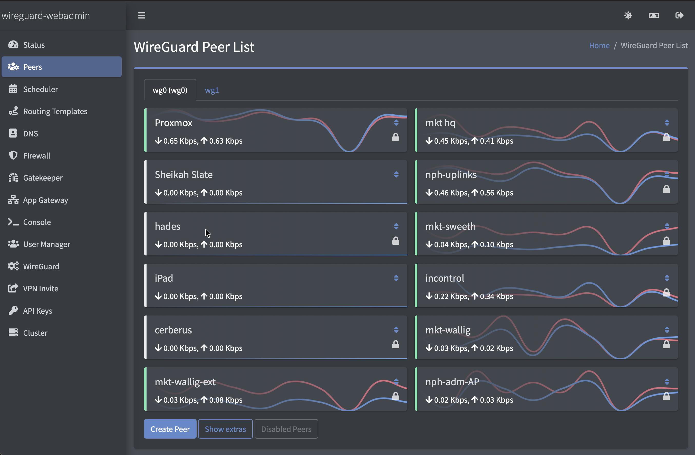
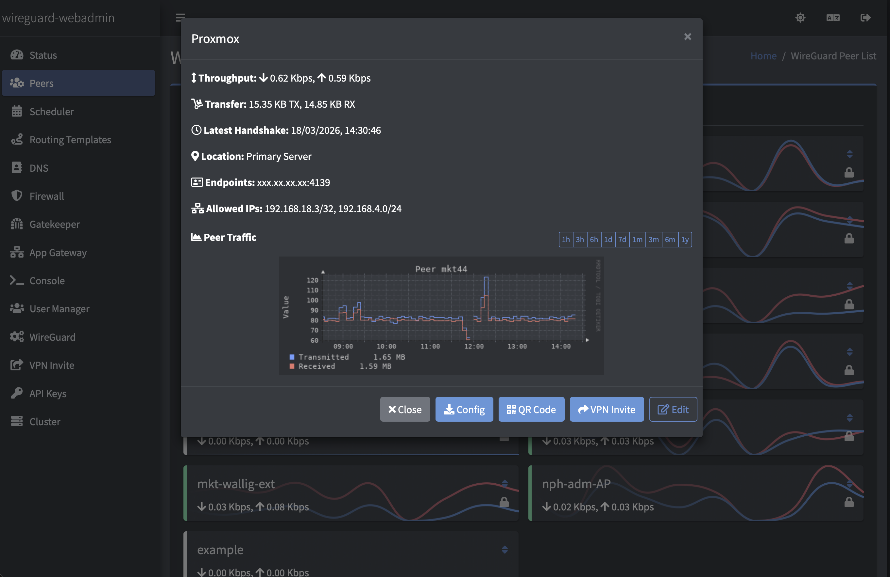
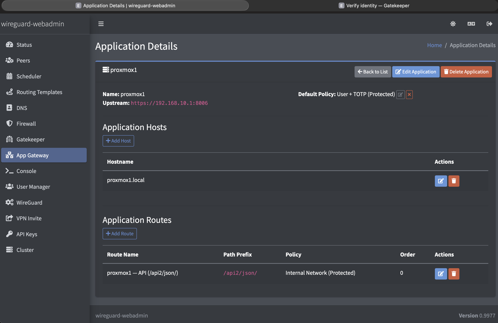
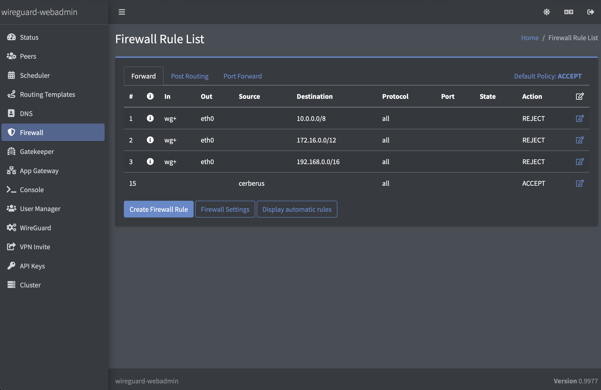
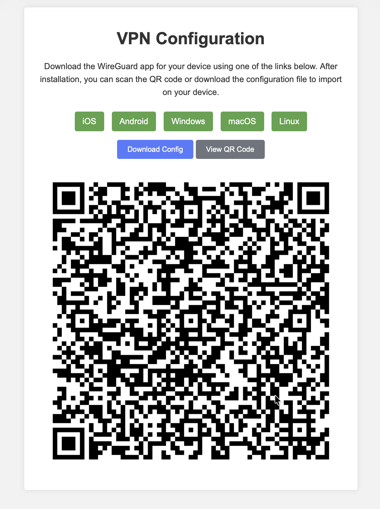

## 🌍 Read this in other languages:
- 🇬🇧 [English](README.md)
- 🇧🇷 [Português](docs/README.pt-br.md)
- 🇪🇸 [Español](docs/README.es.md)
- 🇫🇷 [Français](docs/README.fr.md)
- 🇩🇪 [Deutsch](docs/README.de.md)

✨ If you find any issues with the translation or would like to request a new language, please open an [issue](https://github.com/eduardogsilva/wireguard_webadmin/issues).


# wireguard_webadmin

**Self-hosted VPN management and Zero Trust access control — all on your infrastructure.**

More than a WireGuard panel: manage peers, firewall rules, DNS, port forwarding, and publish internal apps with proper authentication — without relying on third-party services. Runs on any Linux machine with Docker. Free, open source, nothing leaves your server.

- ⚙️ **Manage** — Multiple WireGuard instances, peer traffic graphs, firewall, DNS blacklists, VPN invite links with QR code
- 🔒 **Protect** — Zero Trust application gateway with TOTP, IP ACL, and anti-brute-force (Altcha PoW)
- ⚡ **Automate** — Scheduled peer access, routing templates, expiring invite links, REST API v2

### 📖 Full documentation, installation guide and tips at [wireguard-webadmin.com](https://wireguard-webadmin.com/)

---

## Quick Install

```bash
mkdir wireguard_webadmin && cd wireguard_webadmin
wget -O docker-compose.yml https://raw.githubusercontent.com/eduardogsilva/wireguard_webadmin/main/docker-compose-caddy.yml
# edit .env with your SERVER_ADDRESS
docker compose up -d
```

> **WireGuard ports:** the compose file only publishes UDP ports `51820-51839` for WireGuard instances (and TCP `8080-8089` for port forwarding rules). If an instance uses a different Listen Port, add it to the `ports` section of `docker-compose.yml` and run `docker compose up -d` again, otherwise clients will never complete the handshake. Expose only the ports you need, since Docker handles large port ranges poorly.

> For detailed instructions, upgrade guide, and configuration tips visit **[wireguard-webadmin.com](https://wireguard-webadmin.com/)**.

---

## Screenshots

### Peer List
Real-time status and live bandwidth graphs for every peer across all WireGuard instances.


### Peer Details
Traffic history, last handshake, allowed IPs, and QR code — all in one place.


### Zero Trust Application Gateway
Publish internal apps like Proxmox or Grafana with TOTP authentication in front — no open ports needed.


### Firewall Management
Per-instance iptables rules, port forwarding, and outbound ACLs managed from the UI.


### VPN Invite
Generate a shareable invite with QR code and config file. The user scans or imports it directly into their WireGuard client.


---

## License

This project is licensed under the MIT License - see the [LICENSE](LICENSE) file for details.

## Contributing

Contributions are welcome and greatly appreciated. Feel free to open issues or pull requests on [GitHub](https://github.com/eduardogsilva/wireguard_webadmin).
